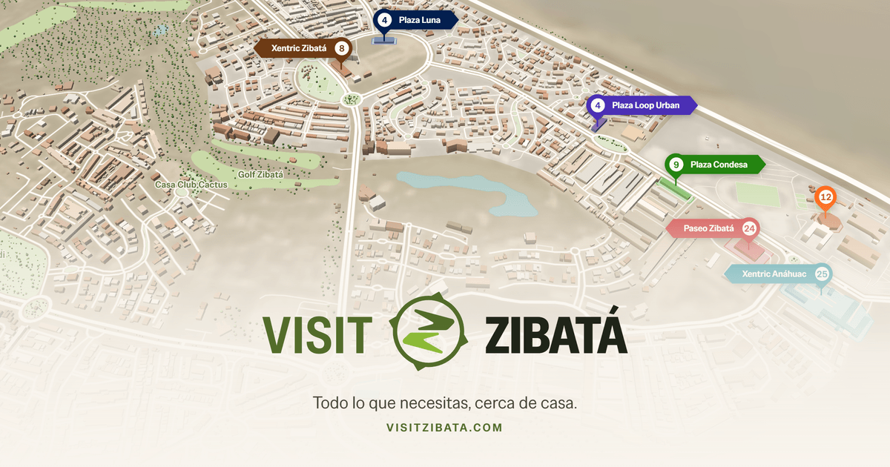

# Visit Zibatá

La guía local de **Zibatá, Querétaro**, en <https://visitzibata.com>. Es un mapa en 3D que se explora:
se elige una zona y se descubren sus lugares, con búsqueda, filtros, ficha de cada establecimiento y
enlace a Google Maps para llegar.



En la interfaz y en las direcciones las agrupaciones de locales se llaman **zonas**; en los datos y el
código, `plaza`.

## Qué tiene

- **Mapa propio** con MapLibre GL JS y teselas generadas aquí: edificios en 3D, calles, áreas verdes y
  agua a partir de OpenStreetMap y Overture Maps. Google Maps solo aparece como enlace para llegar.
- **Sectores, categorías y giros.** Un local tiene hasta tres giros y de ellos se deducen su categoría y
  su sector. La barra de filtros baja de nivel: primero los sectores y, dentro de uno, sus categorías.
- **Búsqueda y filtros**: por texto (tolera acentos y errores menores), por zona, por categoría y por lo
  que está abierto ahora.
- **Español e inglés**, cada idioma con su propio árbol de direcciones.
- **Una página real por ruta**: cada zona, categoría, sector y local tiene su HTML con título,
  descripción, `canonical`, `hreflang` y datos estructurados, y trae su contenido escrito antes de que
  arranque ningún script.
- **Escritorio y móvil**: panel lateral en pantallas anchas y hoja inferior en las estrechas.
- **Accesibilidad**: objetivo WCAG 2.1 AA, navegable con teclado y con pruebas automáticas de axe en
  cada cambio.
- **Sin publicidad, sin reservas y sin reseñas públicas.** Lo único de la comunidad que se ve es cuántas
  personas guardaron cada lugar. Las calificaciones ordenan la guía, pero su media no sale del servidor.

## Cómo está hecho

| Capa | Con qué |
| --- | --- |
| Interfaz | React 19, TypeScript, Vite |
| Mapa | MapLibre GL JS, teselas en PMTiles generadas por `scripts/map` |
| Datos | JSON en `data/commercial`, validados con esquemas de zod |
| Búsqueda | Fuse.js, en el navegador |
| Publicación | Un Worker de Cloudflare que sirve los archivos estáticos y atiende lo mínimo del servidor |
| Calidad | Biome, Vitest, Playwright con axe, Gitleaks y un presupuesto de peso del build |

El sitio es estático: no hay claves de API ni servicios externos en el navegador. Lo único que corre en
el servidor es el Worker de `worker/`, que cuenta visitas por página y día (sin cookies ni IP), guarda lo
que cada persona marca bajo una cuenta anónima sin correo ni nombre, y recibe las sugerencias de cambio.
Si se cae, el sitio sigue funcionando.

## Desarrollo local

Requisitos: Node.js 22.18 o superior (CI usa 24) y npm. Para las pruebas E2E:
`npx playwright install chromium webkit`.

```bash
npm install
npm run dev            # http://localhost:5173
```

Con `?debug` en la dirección (solo en desarrollo) el mapa muestra coordenadas, cámara, identificadores y
límites de teselas.

| Comando | Para qué |
| --- | --- |
| `npm run dev` | Servidor de desarrollo |
| `npm run build` | Valida datos, comprueba tipos y genera `dist/` con las páginas, el sitemap y las teselas |
| `npm run preview` | Sirve `dist/` en local |
| `npm run check` | Lint, tipos, pruebas y build: lo que hay que correr antes de abrir una PR |
| `npm test` | Pruebas unitarias y de componentes (Vitest) |
| `npm run test:e2e` | Pruebas E2E en escritorio, móvil, tableta y WebKit (necesita `npm run build`) |
| `npm run lint` / `npm run lint:fix` | Biome |
| `npm run data:validate` | Valida `data/commercial`; con `-- --fix` recalcula los campos derivados |
| `npm run data:import -- <csv>` | Importa locales desde un CSV (`-- --dry-run` para probar) |
| `npm run perf:budget` | Comprueba el presupuesto de peso del build |
| `npm run map:fetch` | Descarga OpenStreetMap y Overture para el mapa (tarda unos 15 minutos) |
| `npm run map:build` | Genera las teselas y los volúmenes del mapa |

La lista completa está en `package.json`.

## Estructura

```
data/commercial/   categories.json (sectores, categorías y giros) · plazas.json · places.json
data/geographic/   configuración del mapa, extensión y ajustes de edificios
public/            teselas del mapa, iconos, imágenes sociales y manifiesto
scripts/           build (prerenderizado, datos estructurados) · map · data · images · perf
src/               app · components · features · data · i18n · lib · styles
worker/            el servidor mínimo (visitas, cuentas anónimas, sugerencias)
tests/e2e/         Playwright
```

## Los datos

El contenido vive en `data/commercial` y se valida con los esquemas de `src/data/schemas.ts`. Las
reglas del proyecto sobre él:

- **No se inventa nada.** Un horario, un teléfono o una descripción solo figuran si hay una fuente que
  los respalde. Cada registro lleva sus fuentes y la fecha en que se verificó.
- **Verificar en sitio es una fuente.** Muchos negocios de barrio no tienen web ni aparecen en
  plataformas; una visita con fecha vale como respaldo.
- **Fotos:** solo propias o con licencia. Nunca de Google ni de redes sociales.
- **Ocultar no es borrar:** un local que cierra se marca como no visible y conserva su historial.

Los textos de la interfaz están en `src/i18n/es.ts` y `src/i18n/en.ts`. Todo el procesamiento
geográfico ocurre en `scripts/map`, en Node, y no en el navegador.

## El mapa

Se genera en dos pasos: `map:fetch` descarga las fuentes y `map:build` produce `zibata.pmtiles` y los
volúmenes de las plazas. El resultado derivado se prepara solo al correr `dev`, `test` o `build`. El
área, los colores, las capas y la cámara se ajustan en `data/geographic/config.json`,
`src/features/map/style/` y `src/config/map.ts`.

## Publicación

Cada push a `main` ejecuta el workflow de despliegue de GitHub Actions: instalación, búsqueda de secretos,
validación de datos, lint, tipos, pruebas, build, presupuesto de peso y humo E2E, y solo entonces
`wrangler deploy`. Si un paso falla, no se publica nada. Las pull requests corren el CI completo,
incluida la suite E2E.

`npm run build` genera `dist/`, que también sirve cualquier servidor de archivos estáticos. En un
subdirectorio: `BASE_PATH=/subdirectorio/ npm run build`. Basta con que el servidor devuelva 404 para
una ruta inexistente (el build genera `404.html`) y no añada una barra final a los archivos.

## Contribuir

- **Corregir un dato** (un horario, un teléfono, un local que cerró): usa el formulario "Sugiere un
  cambio" dentro de la propia guía.
- **Cambiar el código:** abre una pull request y corre antes `npm run check`; si tocaste la interfaz o
  el mapa, también `npm run test:e2e`. Los imports son relativos y llevan su extensión (`.ts`, `.tsx`),
  porque los scripts corren con Node sin transpilar.
- **Seguridad:** si encuentras una vulnerabilidad, no abras un issue público. Escribe a quien
  mantiene el proyecto por el contacto de su perfil de GitHub.

## Licencias y fuentes

- **Código:** [MIT](LICENSE).
- **Datos comerciales:** [CC BY 4.0](https://creativecommons.org/licenses/by/4.0/deed.es), citando
  "Visit Zibatá (visitzibata.com)".
- **Mapa:** datos © [OpenStreetMap contributors](https://www.openstreetmap.org/copyright), bajo ODbL, y
  [Overture Maps Foundation](https://docs.overturemaps.org/attribution/). Las fuentes, fechas y
  licencias exactas del mapa están en `data/geographic/manifest.json`.
